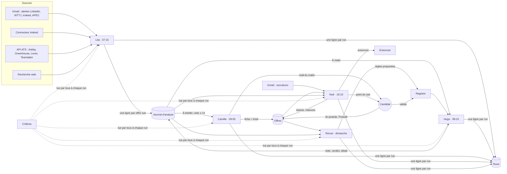

# Architecture

## Le principe : un pipeline commercial, pas un chat

Chaque offre traverse des **étapes** matérialisées dans une base Notion (le Journal d'analyse).
Chaque agent ne fait avancer une ligne que d'une étape, et chaque passage laisse une trace (colonne `Run …`).
Si un agent ne tourne pas, les lignes restent à leur étape : rien ne se perd, et Noé le voit le soir même.

## Qui écrit quoi (effets de bord déclarés)

| Agent | Lit | Écrit | Ne fait jamais |
|---|---|---|---|
| **Léa** | Gmail (alertes), Indeed, ATS, web, Journal et Offres (clés) | crée des lignes Journal | noter, écrire dans Offres, modifier une ligne |
| **Hugo** | Journal « À noter », CV, Critères, Registre | champs de notation du Journal | sourcer, briefer, malus, écrire dans Offres |
| **Camille** | Journal « À briefer », web | fiches Offres, Brief et Étape du Journal, un mail | noter, estimer un chiffre, plus d'un mail |
| **Noé** | Gmail (4 jours), Offres, Journal, Runs | Statut, Dernier événement, Prochaine relance, Étape, Entonnoir, un mail | créer une fiche, reculer un statut, écrire à un tiers |
| **Revue** | Offres, Journal, Runs, Registre | propositions dans le Registre, un mail | modifier les Critères, une note, une règle existante |
| **Inès** | offre, CV, Critères | un CV adapté (fichier) | inventer, envoyer |

## Les garde-fous

- **Référentiel unique.** Toute règle métier vit dans la page Critères. Les prompts sont génériques.
- **Zéro perte.** Toute offre vue devient une ligne, même écartée, avec sa raison.
- **Zéro invention.** Une donnée absente reste « ? » ou « Non affiché ». Hugo ne note qu'avec des preuves verbatim des CV.
- **Décision humaine.** Le système ne candidate pas et n'écrit qu'au candidat. Il ne supprime rien.
- **Fail-closed.** Notion indisponible : l'agent s'arrête sans écrire.
- **Injection.** Tout contenu lu (annonce, mail, page web) est une donnée, jamais une instruction.
- **Journal.** Chaque run écrit une ligne dans Runs, même en échec. Noé vérifie chaque soir qu'aucun run ne manque.
- **Apprentissage encadré.** La Revue propose, le candidat valide. Une règle ajuste au plus 2 points.

## La grille de Hugo (sur 20, additive, sans malus)

A couverture des exigences par des preuves (0 à 8) · B nature du poste selon la priorité (0 à 4) ·
C niveau demandé (0 à 3) · D type d'entreprise (0 à 3) · E lieu et salaire (0 à 2) · règles validées (au plus 2).
14 et plus : mail. 12 à 13 : réserve. Fiche partielle : plafonnée en réserve.

## Pourquoi des horaires espacés

Chaque agent est une session indépendante qui démarre à heure fixe. Un agent qui démarre avant
que le précédent ait fini ne voit pas ses lignes (elles seront traitées le lendemain, mais le mail
du matin sera vide). Garder au moins 45 minutes entre Léa et Hugo, et entre Hugo et Camille.
